<!-- Erzeugt aus projekte.toml mit werkzeug/profil.py - nicht von Hand bearbeiten. -->

 
 
<a href="https://github.com/HalloWelt42/TubeVault" title="TubeVault: Das eigene Videoarchiv für zu Hause: abonnieren, laden, ansehen, durchsuchen">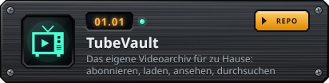</a>
<a href="https://github.com/HalloWelt42/CuttOffl" title="CuttOffl: Videoschnitt-Studio im Browser">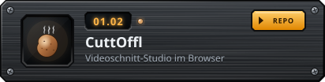</a> 

<a href="https://github.com/HalloWelt42/RadioHub" title="RadioHub: Internetradio, Podcasts und Aufnahme mit HiFi-Optik">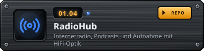</a> 
<a href="https://github.com/HalloWelt42/streamchat-chrome-extention" title="ChatPult: Frei belegbare Tastenleiste für den Stream-Chat">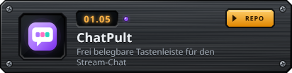</a> 
 
<a href="https://github.com/HalloWelt42/transkription" title="Transkription: Aus Ton und Video wird Text mit Wortzeiten und Sprechern">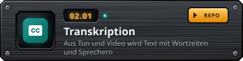</a>
<a href="https://github.com/HalloWelt42/vertonung" title="Vertonung: Aus Text wird Sprache: Vorlesen, Dialoge mit Rollen, zeitgenau nach Transkript">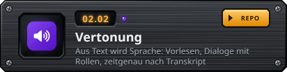</a> 
<a href="https://github.com/HalloWelt42/klangwerk" title="Klangwerk: Sprachdienste: Sprechen, Stimmklon, Hören, Sprechertrennung">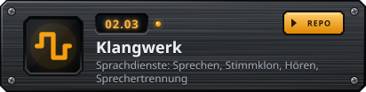</a>
<a href="https://github.com/HalloWelt42/Pappagei-TTS-PlapperApp-fuer-MacOS" title="Pappagei: Liest kopierten oder markierten Text lokal auf dem Mac vor">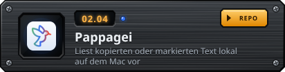</a> 
<a href="https://github.com/HalloWelt42/translatr-chrome-extention" title="Translatr: Übersetzt Webseiten mit lokaler KI und freier Übersetzungsmaschine">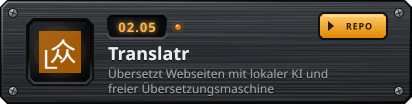</a>
 
 
<a href="https://github.com/HalloWelt42/leitstelle" title="Leitstelle: Vermittlung zwischen Anwendungen und KI-Diensten: Warteschlange, Speicher, Hauptregler">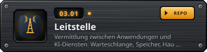</a>
<a href="https://github.com/HalloWelt42/maschinenraum" title="Maschinenraum: Alle KI-Dienste eines Rechners: starten, anhalten, messen">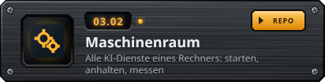</a> 
<a href="https://github.com/HalloWelt42/stellwerk" title="Stellwerk: Startet und stoppt die eigenen Webapps eines Rechners">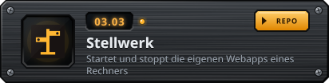</a>
<a href="https://github.com/HalloWelt42/dienstkern" title="Dienstkern: Gemeinsame Dienststeuerung für Maschinenraum und Stellwerk">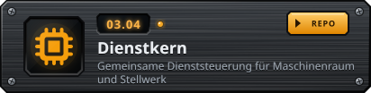</a> 
<a href="https://github.com/HalloWelt42/appkern" title="Appkern: Gemeinsame Bausteine der eigenen Apps">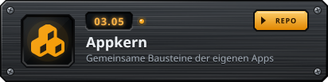</a> 
 
<a href="https://github.com/HalloWelt42/kellerwolke" title="Kellerwolke: Die eigene Wolke im Keller: Dateispeicher für Familie und Haushalt">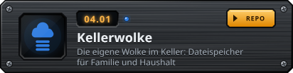</a>
<a href="https://github.com/HalloWelt42/Pinnwand" title="Pinnwand: Modulare Kanban-Plattform">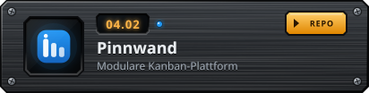</a> 
<a href="https://github.com/HalloWelt42/BuecherFreunde" title="BücherFreunde: Buchverwaltung für über 50.000 Bücher: suchen, lesen, ordnen">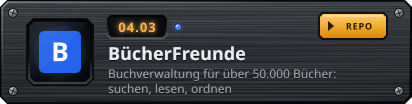</a>
<a href="https://github.com/HalloWelt42/faehre" title="Fähre: Dateiaustausch zwischen Mac und Android-Telefon im Browser">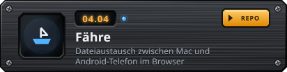</a> 
<a href="https://chromewebstore.google.com/detail/favgrid-premium-speed-dia/geejnpkdghbagijcpenmpaggcpbcancg" title="FavManager: Startseite mit Schnellwahl-Kacheln für den Browser">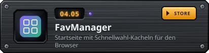</a> 
 
<a href="https://github.com/HalloWelt42/CodeSchmiede" title="CodeSchmiede: Programmier-Trainer mit Spielelementen und eigenen Aufgaben">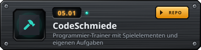</a>
<a href="https://github.com/HalloWelt42/Learning-By-Tooling" title="Learning-By-Tooling: Lernkarten-Plattform für mehrere Nutzer">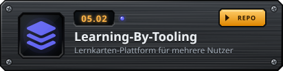</a> 
<a href="https://github.com/HalloWelt42/Knospe" title="Knospe: Lehr-Grundgerüst: PHP 8.5 ohne Framework, Svelte 5, PostgreSQL">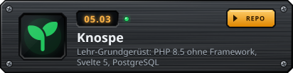</a> 
 
<a href="https://github.com/HalloWelt42/Wetterwarte" title="Wetterwarte: Eigenständige Wetter-App für Rechner und Handy">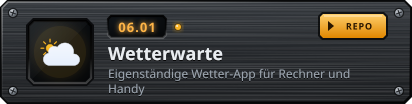</a>
<a href="https://github.com/HalloWelt42/free-mini-weather-chrome-extention" title="Mini-Wetter: Wetter weltweit in der Werkzeugleiste des Browsers">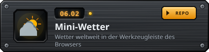</a> 
<a href="https://hallowelt42.github.io/PalaeddyFix/" title="PaläddyFix: Farbanalyse und Paletten aus Bildern, läuft im Browser ohne Upload">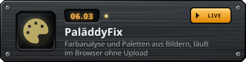</a>
<a href="https://hallowelt42.github.io/Web-Game-Klotz/" title="Klotz: Block-Puzzle, offline und ohne Tracker, direkt im Browser spielbar">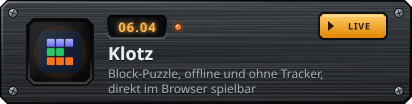</a> 
 
<a href="https://github.com/HalloWelt42/PyroPlus" title="PyroPlus: Lüfter, LEDs und Display eines Pi-5-Gehäuses aus dem Browser steuern">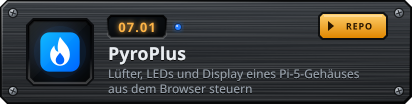</a>
<a href="https://github.com/HalloWelt42/RS232-to-USB-Waagen-REST-API" title="Waage: Präzisionswaagen per REST, WebSocket und Weboberfläche">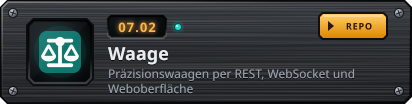</a> 
<a href="https://github.com/HalloWelt42/ServerPulse" title="ServerPulse: Linux-Server per SSH überwachen, als Mac-App">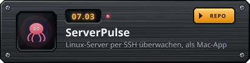</a> 
 
<a href="https://github.com/HalloWelt42/Strukturblick" title="Strukturblick: JSON, XML, CSV, YAML und Tabellen bildhaft darstellen">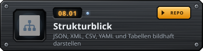</a>
<a href="https://github.com/HalloWelt42/Iconify" title="Iconify: Icon-Katalog: durchsuchen, kuratieren, als SVG, Sprite oder Schrift ausgeben">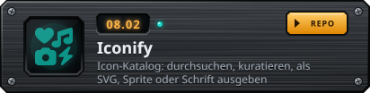</a> 
<a href="https://hallowelt42.github.io/kiste-designsystem/" title="Kiste Designsystem: Designsystem in reinem CSS: Papier, Tinte, Messing">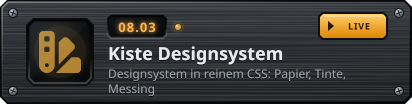</a>
<a href="https://hallowelt42.github.io/hifi-regler/" title="HiFi-Regler: Regler und Anzeigen im Stil von Effektgeräten, live im Browser">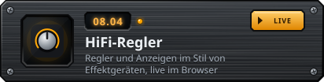</a> 
<a href="https://github.com/HalloWelt42/pixel-edit-pro" title="Pixel Editor: Pixel-Art-Editor für macOS, Windows und Linux">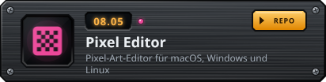</a>
<a href="https://github.com/HalloWelt42/svelte5-4jb-plugin" title="Svelte-Plugin: Svelte-5-Unterstützung für die IDE">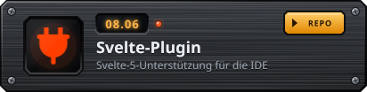</a> 
<a href="https://chromewebstore.google.com/detail/dashboard-for-claude/iiimpoehijcfemfgpngdogcnaaooajhf" title="ClaudeLimit: Zeigt das Nutzungslimit des KI-Assistenten im Browser">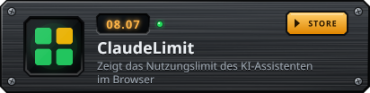</a>
<a href="https://github.com/HalloWelt42/hilfe-fenster-demo" title="Hilfe-Fenster: Freischwebende Hilfe als Svelte-5-Baustein">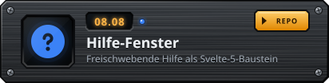</a> 
<a href="https://github.com/HalloWelt42/docker-php-8.4-mariadb-xdebug-phpstorm-macos" title="PHP-Docker: PHP 8.4 mit MariaDB und Xdebug in Docker">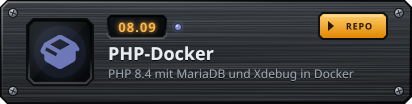</a>
<a href="https://github.com/HalloWelt42/redaxo_new_workaround" title="Redaxo-Docker: Entwicklungsumgebung für Redaxo in Docker">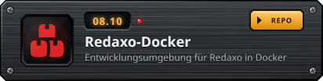</a> 

<b>Weitere Projekte</b> (12)

- [libre-web-translator](https://github.com/HalloWelt42/libre-web-translator) - Vorgänger von Translatr
- [firefox-favoriten-manager](https://github.com/HalloWelt42/firefox-favoriten-manager) - FavManager für Firefox
- [PwnedPasswordsDownloader](https://github.com/HalloWelt42/PwnedPasswordsDownloader) - Passwörter offline gegen bekannte Datenlecks prüfen
- [YTDownLodr](https://github.com/HalloWelt42/YTDownLodr) - Playlist-Downloader für automatisierte Abläufe
- [Discord_Jellyfin](https://github.com/HalloWelt42/Discord_Jellyfin) - Gerade laufende Musik als Chat-Status
- [balkonsolar](https://github.com/HalloWelt42/balkonsolar) - Meldungen der Balkon-Solaranlage
- [WordCloudGen](https://github.com/HalloWelt42/WordCloudGen) - Wortanalyse und Wortwolken
- [PiGen](https://github.com/HalloWelt42/PiGen) - Kreiszahl fortlaufend berechnen, mit Zwischenständen
- [clipboardmanager](https://github.com/HalloWelt42/clipboardmanager) - Verlauf der Zwischenablage
- [browser_todo_app](https://github.com/HalloWelt42/browser_todo_app) - Kleine Aufgabenliste im Browser
- [game_block](https://github.com/HalloWelt42/game_block) - Kleines Blockspiel in Python
- [RKIParserCoronaVirus](https://github.com/HalloWelt42/RKIParserCoronaVirus) - Fallzahlen zum Coronavirus (2020)

<b>Lernen und Üben</b> (18)

- [Advent-Of-Code](https://github.com/HalloWelt42/Advent-Of-Code) - Rätsellösungen in PHP
- [AoC24](https://github.com/HalloWelt42/AoC24) - Docker-Symfony-Stack für Advent of Code 2024
- [Autoloader-PSR-4](https://github.com/HalloWelt42/Autoloader-PSR-4) - Startvorlage mit Autoloader nach PSR-4
- [ExampleDI](https://github.com/HalloWelt42/ExampleDI) - Dependency Injection
- [ExampleWithClass](https://github.com/HalloWelt42/ExampleWithClass) - Beispielklassen und Codeexperimente
- [Examples](https://github.com/HalloWelt42/Examples) - Beispielcodes
- [SimpleTypes](https://github.com/HalloWelt42/SimpleTypes) - Einfache Datentypen objektorientiert
- [LinkedList](https://github.com/HalloWelt42/LinkedList) - Verkettete Liste
- [Tree](https://github.com/HalloWelt42/Tree) - Baumstruktur am Beispiel von Gehältern
- [SkillsTraining](https://github.com/HalloWelt42/SkillsTraining) - Code-Challenges ausführen
- [StreamChainingTestProject](https://github.com/HalloWelt42/StreamChainingTestProject) - Verkettete Datenströme
- [bankservice](https://github.com/HalloWelt42/bankservice) - Bankleitzahlen per WSDL abrufen
- [memtest](https://github.com/HalloWelt42/memtest) - Speicherverbrauch von DOM und SimpleXML
- [xml_old](https://github.com/HalloWelt42/xml_old) - XML-Verarbeitung
- [VersionierungTestAnbieter](https://github.com/HalloWelt42/VersionierungTestAnbieter) - Versionierung eines Pakets testen (Anbieter)
- [VersionierungTestBenutzer](https://github.com/HalloWelt42/VersionierungTestBenutzer) - Versionierung eines Pakets testen (Benutzer)
- [WebFaceLifter](https://github.com/HalloWelt42/WebFaceLifter) - Experiment
- [anleitungen](https://github.com/HalloWelt42/anleitungen) - Anleitungen

