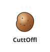
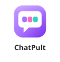
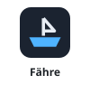
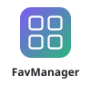
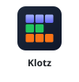

<!-- Erzeugt aus projekte.toml mit werkzeug/profil.py - nicht von Hand bearbeiten. -->

<h1 align="center">Alle Projekte</h1>

  <em>Selbst gehostete Werkzeuge für alle, die wissen wollen, wo ihre Daten liegen.</em> 
  Keine Cloud. Kein Tracking. Läuft auf eigener Hardware.

  <a href="https://github.com/HalloWelt42">Zurück zum Profil</a>

<h3 align="center">Video und Audio</h3>

Ansehen, schneiden, mitschneiden, hören.

<a href="https://github.com/HalloWelt42/TubeVault" title="TubeVault - Das eigene Videoarchiv für zu Hause: abonnieren, laden, ansehen, durchsuchen"><picture><source media="(prefers-color-scheme: dark)" srcset="kacheln/dunkel/tubevault.svg"></picture></a>
<a href="https://github.com/HalloWelt42/CuttOffl" title="CuttOffl - Videoschnitt-Studio im Browser"><picture><source media="(prefers-color-scheme: dark)" srcset="kacheln/dunkel/cuttoffl.svg"></picture></a>
<a href="https://chromewebstore.google.com/detail/video-hls-stream-download/pdhppamhikghebahhelhinciheheajaa" title="StreamREC - Videostreams (HLS, DASH, MP4) direkt im Browser speichern"><picture><source media="(prefers-color-scheme: dark)" srcset="kacheln/dunkel/streamrec.svg"></picture></a>
<a href="https://github.com/HalloWelt42/blob-media-downloadr-chrome-extension" title="Blob Downloadr - Medien hinter blob:-Adressen als Datei speichern, auch Streaming-Videos"><picture><source media="(prefers-color-scheme: dark)" srcset="kacheln/dunkel/blob-downloadr.svg"></picture></a>
<a href="https://github.com/HalloWelt42/RadioHub" title="RadioHub - Internetradio, Podcasts und Aufnahme mit HiFi-Optik"><picture><source media="(prefers-color-scheme: dark)" srcset="kacheln/dunkel/radiohub.svg"></picture></a>
<a href="https://github.com/HalloWelt42/TransPlay" title="TransPlay - Audio synchron zum Transkript abspielen"><picture><source media="(prefers-color-scheme: dark)" srcset="kacheln/dunkel/transplay.svg"></picture></a>
<a href="https://github.com/HalloWelt42/streamchat-chrome-extention" title="ChatPult - Frei belegbare Tastenleiste für den Stream-Chat"><picture><source media="(prefers-color-scheme: dark)" srcset="kacheln/dunkel/chatpult.svg"></picture></a>

<h3 align="center">Sprache und Text</h3>

Lokale KI für Sprechen, Hören, Übersetzen und Nachschlagen.

<a href="https://github.com/HalloWelt42/transkription" title="Transkription - Aus Ton und Video wird Text mit Wortzeiten und Sprechern"><picture><source media="(prefers-color-scheme: dark)" srcset="kacheln/dunkel/transkription.svg"></picture></a>
<a href="https://github.com/HalloWelt42/vertonung" title="Vertonung - Aus Text wird Sprache: Vorlesen, Dialoge mit Rollen, zeitgenau nach Transkript"><picture><source media="(prefers-color-scheme: dark)" srcset="kacheln/dunkel/vertonung.svg"></picture></a>
<a href="https://github.com/HalloWelt42/klangwerk" title="Klangwerk - Sprachdienste: Sprechen, Stimmklon, Hören, Sprechertrennung"><picture><source media="(prefers-color-scheme: dark)" srcset="kacheln/dunkel/klangwerk.svg"></picture></a>
<a href="https://github.com/HalloWelt42/Pappagei-TTS-PlapperApp-fuer-MacOS" title="Pappagei - Liest kopierten oder markierten Text lokal auf dem Mac vor"><picture><source media="(prefers-color-scheme: dark)" srcset="kacheln/dunkel/pappagei.svg"></picture></a>
<a href="https://github.com/HalloWelt42/translatr-chrome-extention" title="Translatr - Übersetzt Webseiten mit lokaler KI und freier Übersetzungsmaschine"><picture><source media="(prefers-color-scheme: dark)" srcset="kacheln/dunkel/translatr.svg"></picture></a>
<a href="https://github.com/HalloWelt42/Federflink" title="Federflink - Rechtschreibprüfung im eigenen Netz"><picture><source media="(prefers-color-scheme: dark)" srcset="kacheln/dunkel/federflink.svg"></picture></a>
<a href="https://github.com/HalloWelt42/morf-gpt" title="morf-gpt - Wissensbibliothek und Chat über Erklärvideos"><picture><source media="(prefers-color-scheme: dark)" srcset="kacheln/dunkel/morf-gpt.svg"></picture></a>

<h3 align="center">KI-Verbund</h3>

Der Unterbau: Die Leitstelle vermittelt, Maschinenraum und Stellwerk betreiben Dienste und Apps.

<a href="https://github.com/HalloWelt42/leitstelle" title="Leitstelle - Vermittlung zwischen Anwendungen und KI-Diensten: Warteschlange, Speicher, Hauptregler"><picture><source media="(prefers-color-scheme: dark)" srcset="kacheln/dunkel/leitstelle.svg"></picture></a>
<a href="https://github.com/HalloWelt42/maschinenraum" title="Maschinenraum - Alle KI-Dienste eines Rechners: starten, anhalten, messen"><picture><source media="(prefers-color-scheme: dark)" srcset="kacheln/dunkel/maschinenraum.svg"></picture></a>
<a href="https://github.com/HalloWelt42/stellwerk" title="Stellwerk - Startet und stoppt die eigenen Webapps eines Rechners"><picture><source media="(prefers-color-scheme: dark)" srcset="kacheln/dunkel/stellwerk.svg"></picture></a>
<a href="https://github.com/HalloWelt42/dienstkern" title="Dienstkern - Gemeinsame Dienststeuerung für Maschinenraum und Stellwerk"><picture><source media="(prefers-color-scheme: dark)" srcset="kacheln/dunkel/dienstkern.svg"></picture></a>
<a href="https://github.com/HalloWelt42/appkern" title="Appkern - Gemeinsame Bausteine der eigenen Apps"><picture><source media="(prefers-color-scheme: dark)" srcset="kacheln/dunkel/appkern.svg"></picture></a>

<h3 align="center">Ordnen und Teilen</h3>

Dateien, Aufgaben, Bücher und Lesezeichen an einem Ort.

<a href="https://github.com/HalloWelt42/kellerwolke" title="Kellerwolke - Die eigene Wolke im Keller: Dateispeicher für Familie und Haushalt"><picture><source media="(prefers-color-scheme: dark)" srcset="kacheln/dunkel/kellerwolke.svg"></picture></a>
<a href="https://github.com/HalloWelt42/Pinnwand" title="Pinnwand - Modulare Kanban-Plattform"><picture><source media="(prefers-color-scheme: dark)" srcset="kacheln/dunkel/pinnwand.svg"></picture></a>
<a href="https://github.com/HalloWelt42/BuecherFreunde" title="BücherFreunde - Buchverwaltung für über 50.000 Bücher: suchen, lesen, ordnen"><picture><source media="(prefers-color-scheme: dark)" srcset="kacheln/dunkel/buecherfreunde.svg"></picture></a>
<a href="https://github.com/HalloWelt42/faehre" title="Fähre - Dateiaustausch zwischen Mac und Android-Telefon im Browser"><picture><source media="(prefers-color-scheme: dark)" srcset="kacheln/dunkel/faehre.svg"></picture></a>
<a href="https://chromewebstore.google.com/detail/favgrid-premium-speed-dia/geejnpkdghbagijcpenmpaggcpbcancg" title="FavManager - Startseite mit Schnellwahl-Kacheln für den Browser"><picture><source media="(prefers-color-scheme: dark)" srcset="kacheln/dunkel/favmanager.svg"></picture></a>
<a href="https://github.com/HalloWelt42/macos-dev-organizer" title="DevRadar - Lokale Projekte auf dem Mac finden und ordnen"><picture><source media="(prefers-color-scheme: dark)" srcset="kacheln/dunkel/devradar.svg"></picture></a>

<h3 align="center">Lernen</h3>

Üben mit eigenen Aufgaben und Lernkarten.

<a href="https://github.com/HalloWelt42/CodeSchmiede" title="CodeSchmiede - Programmier-Trainer mit Spielelementen und eigenen Aufgaben"><picture><source media="(prefers-color-scheme: dark)" srcset="kacheln/dunkel/codeschmiede.svg"></picture></a>
<a href="https://github.com/HalloWelt42/Learning-By-Tooling" title="Learning-By-Tooling - Lernkarten-Plattform für mehrere Nutzer"><picture><source media="(prefers-color-scheme: dark)" srcset="kacheln/dunkel/learning-by-tooling.svg"></picture></a>
<a href="https://github.com/HalloWelt42/Knospe" title="Knospe - Lehr-Grundgerüst: PHP 8.5 ohne Framework, Svelte 5, PostgreSQL"><picture><source media="(prefers-color-scheme: dark)" srcset="kacheln/dunkel/knospe.svg"></picture></a>

<h3 align="center">Alltag und Spiel</h3>

Wetter, Farben und eine Runde Klötze.

<a href="https://github.com/HalloWelt42/Wetterwarte" title="Wetterwarte - Eigenständige Wetter-App für Rechner und Handy"><picture><source media="(prefers-color-scheme: dark)" srcset="kacheln/dunkel/wetterwarte.svg"></picture></a>
<a href="https://github.com/HalloWelt42/free-mini-weather-chrome-extention" title="Mini-Wetter - Wetter weltweit in der Werkzeugleiste des Browsers"><picture><source media="(prefers-color-scheme: dark)" srcset="kacheln/dunkel/mini-wetter.svg"></picture></a>
<a href="https://hallowelt42.github.io/PalaeddyFix/" title="PaläddyFix - Farbanalyse und Paletten aus Bildern, läuft im Browser ohne Upload"><picture><source media="(prefers-color-scheme: dark)" srcset="kacheln/dunkel/palaeddyfix.svg"></picture></a>
<a href="https://hallowelt42.github.io/Web-Game-Klotz/" title="Klotz - Block-Puzzle, offline und ohne Tracker, direkt im Browser spielbar"><picture><source media="(prefers-color-scheme: dark)" srcset="kacheln/dunkel/klotz.svg"></picture></a>

<h3 align="center">Hardware und Server</h3>

Raspberry Pi, Waagen und Server im Blick.

<a href="https://github.com/HalloWelt42/PyroPlus" title="PyroPlus - Lüfter, LEDs und Display eines Pi-5-Gehäuses aus dem Browser steuern"><picture><source media="(prefers-color-scheme: dark)" srcset="kacheln/dunkel/pyroplus.svg"></picture></a>
<a href="https://github.com/HalloWelt42/RS232-to-USB-Waagen-REST-API" title="Waage - Präzisionswaagen per REST, WebSocket und Weboberfläche"><picture><source media="(prefers-color-scheme: dark)" srcset="kacheln/dunkel/waage.svg"></picture></a>
<a href="https://github.com/HalloWelt42/ServerPulse" title="ServerPulse - Linux-Server per SSH überwachen, als Mac-App"><picture><source media="(prefers-color-scheme: dark)" srcset="kacheln/dunkel/serverpulse.svg"></picture></a>
<a href="https://github.com/HalloWelt42/Caddy-UI-Client" title="Caddy Manager - Webserver mit automatischem HTTPS vom Mac aus verwalten"><picture><source media="(prefers-color-scheme: dark)" srcset="kacheln/dunkel/caddy-manager.svg"></picture></a>
<a href="https://github.com/HalloWelt42/raspberry_pi_projects" title="Pi-Projekte - Einrichtungsanleitungen für Dienste auf dem Raspberry Pi 5"><picture><source media="(prefers-color-scheme: dark)" srcset="kacheln/dunkel/pi-projekte.svg"></picture></a>

<h3 align="center">Für Entwickler</h3>

Werkzeuge, Vorlagen und Bausteine.

<a href="https://github.com/HalloWelt42/Strukturblick" title="Strukturblick - JSON, XML, CSV, YAML und Tabellen bildhaft darstellen"><picture><source media="(prefers-color-scheme: dark)" srcset="kacheln/dunkel/strukturblick.svg"></picture></a>
<a href="https://github.com/HalloWelt42/Iconify" title="Iconify - Icon-Katalog: durchsuchen, kuratieren, als SVG, Sprite oder Schrift ausgeben"><picture><source media="(prefers-color-scheme: dark)" srcset="kacheln/dunkel/iconify.svg"></picture></a>
<a href="https://hallowelt42.github.io/regex404-offline/" title="Regex404 - Reguläre Ausdrücke testen, offline im Browser"><picture><source media="(prefers-color-scheme: dark)" srcset="kacheln/dunkel/regex404.svg"></picture></a>
<a href="https://hallowelt42.github.io/kiste-designsystem/" title="Kiste Designsystem - Designsystem in reinem CSS: Papier, Tinte, Messing"><picture><source media="(prefers-color-scheme: dark)" srcset="kacheln/dunkel/kiste-designsystem.svg"></picture></a>
<a href="https://hallowelt42.github.io/hifi-regler/" title="HiFi-Regler - Regler und Anzeigen im Stil von Effektgeräten, live im Browser"><picture><source media="(prefers-color-scheme: dark)" srcset="kacheln/dunkel/hifi-regler.svg"></picture></a>
<a href="https://github.com/HalloWelt42/pixel-edit-pro" title="Pixel Editor - Pixel-Art-Editor für macOS, Windows und Linux"><picture><source media="(prefers-color-scheme: dark)" srcset="kacheln/dunkel/pixel-editor.svg"></picture></a>
<a href="https://github.com/HalloWelt42/svelte5-4jb-plugin" title="Svelte-Plugin - Svelte-5-Unterstützung für die IDE"><picture><source media="(prefers-color-scheme: dark)" srcset="kacheln/dunkel/svelte-plugin.svg"></picture></a>
<a href="https://chromewebstore.google.com/detail/dashboard-for-claude/iiimpoehijcfemfgpngdogcnaaooajhf" title="ClaudeLimit - Zeigt das Nutzungslimit des KI-Assistenten im Browser"><picture><source media="(prefers-color-scheme: dark)" srcset="kacheln/dunkel/claudelimit.svg"></picture></a>
<a href="https://github.com/HalloWelt42/PyQt6ComponentFramework" title="Qt-Komponenten - Reaktives Komponenten-Framework für Qt-Anwendungen in Python"><picture><source media="(prefers-color-scheme: dark)" srcset="kacheln/dunkel/qt-komponenten.svg"></picture></a>
<a href="https://github.com/HalloWelt42/hilfe-fenster-demo" title="Hilfe-Fenster - Freischwebende Hilfe als Svelte-5-Baustein"><picture><source media="(prefers-color-scheme: dark)" srcset="kacheln/dunkel/hilfe-fenster.svg"></picture></a>
<a href="https://github.com/HalloWelt42/docker-php-8.4-mariadb-xdebug-phpstorm-macos" title="PHP-Docker - PHP 8.4 mit MariaDB und Xdebug in Docker"><picture><source media="(prefers-color-scheme: dark)" srcset="kacheln/dunkel/php-docker.svg"></picture></a>
<a href="https://github.com/HalloWelt42/redaxo_new_workaround" title="Redaxo-Docker - Entwicklungsumgebung für Redaxo in Docker"><picture><source media="(prefers-color-scheme: dark)" srcset="kacheln/dunkel/redaxo-docker.svg"></picture></a>

 

<b>Weitere Projekte</b> (12)

- [libre-web-translator](https://github.com/HalloWelt42/libre-web-translator) - Vorgänger von Translatr
- [firefox-favoriten-manager](https://github.com/HalloWelt42/firefox-favoriten-manager) - FavManager für Firefox
- [PwnedPasswordsDownloader](https://github.com/HalloWelt42/PwnedPasswordsDownloader) - Passwörter offline gegen bekannte Datenlecks prüfen
- [YTDownLodr](https://github.com/HalloWelt42/YTDownLodr) - Playlist-Downloader für automatisierte Abläufe
- [Discord_Jellyfin](https://github.com/HalloWelt42/Discord_Jellyfin) - Gerade laufende Musik als Chat-Status
- [balkonsolar](https://github.com/HalloWelt42/balkonsolar) - Meldungen der Balkon-Solaranlage
- [WordCloudGen](https://github.com/HalloWelt42/WordCloudGen) - Wortanalyse und Wortwolken
- [PiGen](https://github.com/HalloWelt42/PiGen) - Kreiszahl fortlaufend berechnen, mit Zwischenständen
- [clipboardmanager](https://github.com/HalloWelt42/clipboardmanager) - Verlauf der Zwischenablage
- [browser_todo_app](https://github.com/HalloWelt42/browser_todo_app) - Kleine Aufgabenliste im Browser
- [game_block](https://github.com/HalloWelt42/game_block) - Kleines Blockspiel in Python
- [RKIParserCoronaVirus](https://github.com/HalloWelt42/RKIParserCoronaVirus) - Fallzahlen zum Coronavirus (2020)

<b>Lernen und Üben</b> (18)

- [Advent-Of-Code](https://github.com/HalloWelt42/Advent-Of-Code) - Rätsellösungen in PHP
- [AoC24](https://github.com/HalloWelt42/AoC24) - Docker-Symfony-Stack für Advent of Code 2024
- [Autoloader-PSR-4](https://github.com/HalloWelt42/Autoloader-PSR-4) - Startvorlage mit Autoloader nach PSR-4
- [ExampleDI](https://github.com/HalloWelt42/ExampleDI) - Dependency Injection
- [ExampleWithClass](https://github.com/HalloWelt42/ExampleWithClass) - Beispielklassen und Codeexperimente
- [Examples](https://github.com/HalloWelt42/Examples) - Beispielcodes
- [SimpleTypes](https://github.com/HalloWelt42/SimpleTypes) - Einfache Datentypen objektorientiert
- [LinkedList](https://github.com/HalloWelt42/LinkedList) - Verkettete Liste
- [Tree](https://github.com/HalloWelt42/Tree) - Baumstruktur am Beispiel von Gehältern
- [SkillsTraining](https://github.com/HalloWelt42/SkillsTraining) - Code-Challenges ausführen
- [StreamChainingTestProject](https://github.com/HalloWelt42/StreamChainingTestProject) - Verkettete Datenströme
- [bankservice](https://github.com/HalloWelt42/bankservice) - Bankleitzahlen per WSDL abrufen
- [memtest](https://github.com/HalloWelt42/memtest) - Speicherverbrauch von DOM und SimpleXML
- [xml_old](https://github.com/HalloWelt42/xml_old) - XML-Verarbeitung
- [VersionierungTestAnbieter](https://github.com/HalloWelt42/VersionierungTestAnbieter) - Versionierung eines Pakets testen (Anbieter)
- [VersionierungTestBenutzer](https://github.com/HalloWelt42/VersionierungTestBenutzer) - Versionierung eines Pakets testen (Benutzer)
- [WebFaceLifter](https://github.com/HalloWelt42/WebFaceLifter) - Experiment
- [anleitungen](https://github.com/HalloWelt42/anleitungen) - Anleitungen

---

  Alle Projekte sind kostenlos und werbefrei. Wenn dir gefällt, was ich mache:
  <a href="https://ko-fi.com/HalloWelt42">Unterstützen</a>

